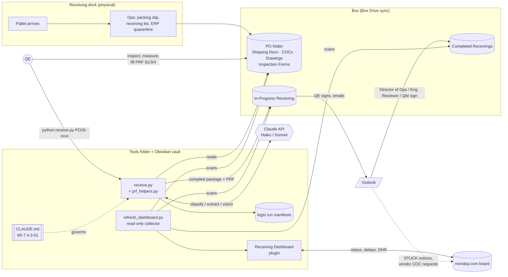
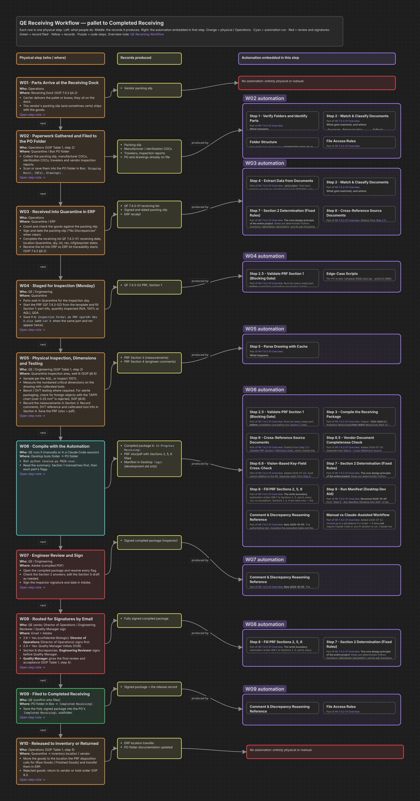
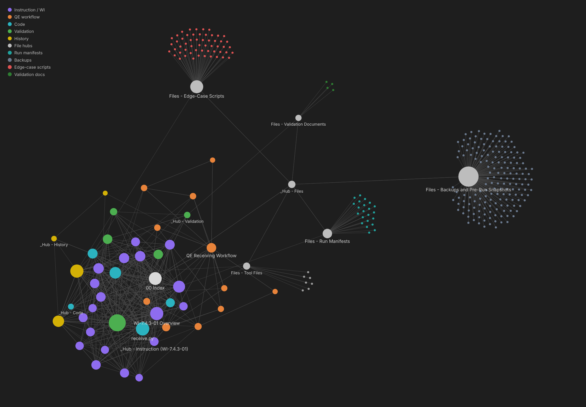

# Receiving Inspection Automation

**AI-assisted incoming-inspection paperwork for a regulated medical-device QMS.** Python compiles each received part's document package and pre-fills the Quality Product Release Form (PRF). An Obsidian vault maps the project and shows a live dashboard. Box, monday.com, Outlook and the Claude API connect the steps between the receiving dock and a signed release record.

> **Status:** in active use, validation in progress. The tool produces **drafts for human review**. It never approves or releases product, and the existing signature chain is unchanged.


---

## Why this exists

When incoming product arrives, a Quality Engineer (QE) has to do two very different jobs:

1. **Judgement work.** Inspect, measure critical dimensions, bench-test and decide.
2. **Paperwork.** Find the PO, packing slip, receiving list, drawing, manufacturer COCs, sterilization certificates and travelers. Check that part numbers, revisions, lots and quantities agree across all of them, answer the six Section 2 checklist questions, merge everything into one package in a fixed order, then route it for signatures.

The second job is mechanical, slow and error-prone, and it is the one auditors read line by line. This project automates it, so engineers can spend their time on inspection and testing. Every judgement still belongs to a person.

## What's in the box

| Piece | What it does | Docs |
|---|---|---|
| **`receive.py` + `prf_helpers.py`** | CLI. Reads a PO folder, classifies and matches documents per part, cross-checks them, decides PRF Section 2 with **fixed Python rules**, fills PRF Sections 2/5/6, compiles one signed-ready PDF package per part and writes a run manifest. | [Using receive.py](docs/03-using-receive-py.md) · [Pipeline](docs/04-pipeline-steps.md) |
| **`CLAUDE.md` (WI-7.4.3-01)** | The controlled work instruction. It is the spec the code implements, and Claude Code reads it on launch. | [Architecture](docs/01-architecture.md) |
| **Obsidian vault ("Project Map")** | Index, hubs, a note for every WI step, code module and validation document, two canvases and a color-coded graph. | [Obsidian vault](docs/05-obsidian-vault.md) |
| **Receiving Dashboard plugin** | Live status of every PO and part from Box, the test matrix, the workflow, a file navigator, delay analytics and monday.com DHR automation. | [Dashboard](docs/06-receiving-dashboard.md) |
| **Integrations** | Box (documents and records), monday.com (production tracking), Outlook (vendor requests, signature routing, STUCK notices) and the Claude API (classification, extraction, vision). | [Box](docs/integrations/box.md) · [monday.com](docs/integrations/monday.md) · [Outlook](docs/integrations/outlook.md) · [Claude API](docs/integrations/claude-api.md) |
| **Validation package** | Protocol, test case matrix and instruction guide. These follow 21 CFR 820 / ISO 13485 software-validation expectations. | [Validation & compliance](docs/07-validation-and-compliance.md) |

## How it fits together



## Screenshots

All screenshots render the **real plugin code and vault structure** with **synthetic demo data**: invented vendors (Northwind, Contoso, Fabrikam…), part numbers `SR90-xxxx` and POs `PO26-12xx`. Nothing in them is a real record. The harness that makes them is in [`tools/screenshot-harness`](tools/screenshot-harness).

| | |
|---|---|
|  **POs & parts:** every PO folder, sign-off progress, which tool ran it, monday status |  **Delays:** what is Stuck or waiting for signature, why, and the playbook fix |
|  **QE workflow canvas:** each physical step, the records it produces and the automation embedded in it |  **Graph view:** instruction, code, validation, history and workflow clusters, with the files the automation produces |

More screenshots are on the [dashboard page](docs/06-receiving-dashboard.md) and the [vault page](docs/05-obsidian-vault.md).

## Quick start

```powershell
# 1. Put the tools folder somewhere local (it's also the Obsidian vault)
git clone https://github.com/<you>/receiving-inspection-automation.git
cd receiving-inspection-automation\tools-folder
pip install -r requirements.txt            # anthropic, pdfplumber, openpyxl, pymupdf
# + LibreOffice (PRF → PDF) and Ghostscript (unlocked compiled PDFs)

# 2. API key for the Claude calls
[System.Environment]::SetEnvironmentVariable("ANTHROPIC_API_KEY", "sk-ant-...", "User")

# 3. Run on a PO folder (run it FROM the PO folder; the tool never reads outside it)
cd "C:\Users\<you>\Box\Shared\Purchase Orders\2026\26-0085 - VendorA"
python "C:\path\to\tools-folder\receive.py" PO26-0085
```

Then open `tools-folder` as a vault in Obsidian, enable the **Receiving Dashboard** community plugin and click the gauge icon. Full setup is in [docs/02-setup.md](docs/02-setup.md).

> You'll also need your own copy of the PRF Excel template in `templates/` and your own approved-destination catalog. Both are controlled company documents and are **not** in this repo. See [docs/02-setup.md](docs/02-setup.md#company-files-you-must-supply).

## Design principles

1. **Draft, never decide.** The output is a pre-filled draft. The engineer reviews and signs, and the Director of Operations, Engineering Reviewer and Quality Manager sign in the same order as before automation.
2. **Deterministic where it matters.** Section 2 checklist answers (2.1–2.6) and the disposition come from **pure Python rules**, never from a model. The model reads documents. It doesn't make quality decisions.
3. **Flag, don't guess.** A missing or conflicting fact produces a `FLAG` or `MISMATCH` and leaves the checkbox empty. Blocking is reserved for states that can't be resolved, such as a PO revision conflict or a Section 1 mismatch.
4. **Narrow write boundary.** The automation writes PRF Sections **2, 5 and 6** only. Sections 1, 3 and 4 belong to the engineer and are read-only to the tool.
5. **Stay inside the PO folder.** The tool refuses any path outside its working directory. The dashboard is read-only on Box.
6. **The spec is a controlled document.** `CLAUDE.md` is WI-7.4.3-01. Code and WI change together, and every fix gets a test case in the matrix.

## Repository layout

```
.
├── README.md
├── docs/
│   ├── 01-architecture.md         system design, data flow, trust boundaries
│   ├── 02-setup.md                install, config, company files you must supply
│   ├── 03-using-receive-py.md     day-to-day use, output, flags, what to do after
│   ├── 04-pipeline-steps.md       Steps 1–9, Section 2 rules, package order, PRF cell map
│   ├── 05-obsidian-vault.md       vault layout, canvases, graph view, file map
│   ├── 06-receiving-dashboard.md  every dashboard tab, search syntax, settings
│   ├── 07-validation-and-compliance.md
│   ├── 08-security-and-privacy.md
│   ├── 09-troubleshooting.md
│   ├── integrations/  box.md · monday.md · outlook.md · claude-api.md
│   └── images/                    screenshots (synthetic data)
├── tools-folder/                  ← copy this to the QE's machine; it is the tool AND the vault
│   ├── CLAUDE.md                  WI-7.4.3-01 (public excerpt)
│   ├── receive.py · prf_helpers.py · receive.bat · requirements.txt
│   ├── templates/  logs/          (empty; supply your own PRF template)
│   ├── Project Map/               Obsidian notes, canvases, _scripts/ (dashboard collector)
│   └── .obsidian/plugins/receiving-dashboard/   main.js · styles.css · manifest.json
├── examples/                      synthetic dashboard data, monday response, run manifest
└── tools/screenshot-harness/      renders the docs screenshots from demo data
```

## About this public copy

This repo is a **sanitized** copy of an internal project. Company, vendor, product, person, PO, part and lot identifiers have been replaced with placeholders (`ACME Medical`, `VendorA`…`VendorL`, `ProductX`, `PO26-1xxx`, `SR90-xxxx`, role names instead of people). Real run logs, case studies, edge-case scripts, the PRF template, the product catalog, API tokens and every vendor document are excluded. Internal QMS document *numbers* (SOP 7.4.3, QF 7.4.3-02, WI-7.4.3-01) are kept so the cross-references make sense. See [docs/08-security-and-privacy.md](docs/08-security-and-privacy.md).

The code is shown as a reference implementation. It is tuned to one company's forms and folder conventions, so expect to adapt `F_*` folder names, the PRF cell map and the Section 2 vendor rules before it works for you.
