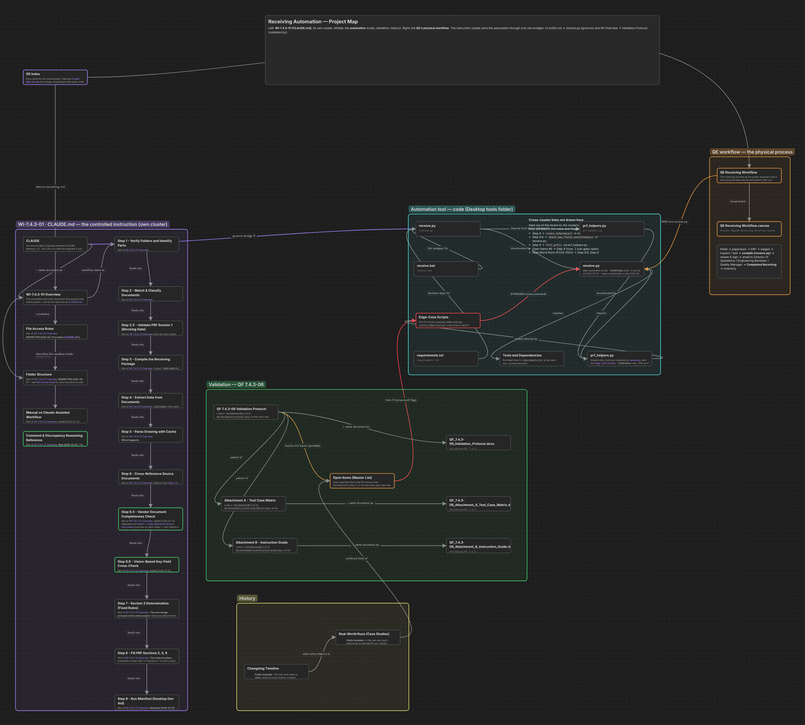
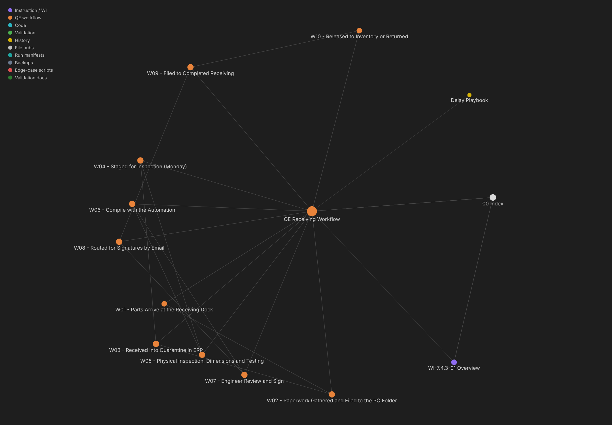

# 05 · The Obsidian vault ("Project Map")

The tools folder doubles as an Obsidian vault. Notes live next to the code they describe, so opening the vault gives you the WI, the implementation, the validation status and the physical workflow, all cross-linked.

## Layout

```
tools-folder/                       ← vault root
├── CLAUDE.md                       WI-7.4.3-01 (the controlled instruction)
├── Project Map/
│   ├── 00 Index.md                 entry point / map of content
│   ├── 01 Governance/              one note per WI step + rules (purple)
│   │   ├── _Hub - Instruction (WI-7.4.3-01).md
│   │   ├── WI-7.4.3-01 Overview.md
│   │   ├── Step 1 … Step 9 (+ 2.5, 6.5, 6.6)
│   │   ├── File Access Rules.md · Folder Structure.md
│   │   ├── Manual vs Claude-Assisted Workflow.md
│   │   └── Comment & Discrepancy Reasoning Reference.md
│   ├── 02 Code/                    receive.py.md, prf_helpers.py.md, deps, edge-case scripts (cyan)
│   ├── 03 Validation/              Protocol, Attachment A matrix, Attachment B guide, Open Items (green)
│   ├── 04 History/                 Changelog, Real-World Runs, Delay Playbook (yellow)
│   ├── 05 QE Workflow/             QE Receiving Workflow + W01…W10, one per physical step (orange)
│   ├── 06 Files/                   generated hubs that link every non-note file (grey)
│   ├── Project Map.canvas          visual board of the whole project
│   ├── QE Receiving Workflow.canvas  pallet → Completed Receiving, row per step
│   └── _scripts/                   dashboard collector + file-map generator + scheduler
└── .obsidian/
    ├── graph.json                  Graph view color groups
    └── plugins/receiving-dashboard/
```

### How notes are written

- **One subject per note.** Each WI step, each code module and each validation document gets its own note.
- **Status lives at the top.** Notes say what changed and when, for example "*REWRITTEN 2026-09-11*". Superseded statements are struck through (`~~…~~`) with a dated note, not deleted. That way the vault keeps the history an auditor might ask about.
- **Links carry meaning.** `Part of [[WI-7.4.3-01 Overview]]`, `Feeds into [[Step 6 …]]`, `Implemented by [[receive.py]]`, `Validated by [[Attachment A …]]`.
- **The Markdown is authoritative.** Canvases and the graph are views of it.

## Canvas 1 · Project Map



Five clusters, each a canvas **group**:

| Group | Color | Contents |
|---|---|---|
| WI-7.4.3-01 · CLAUDE.md | purple | the instruction and every step note, chained by `feeds into` edges |
| Automation tool | cyan | `receive.py`, `prf_helpers.py`, `receive.bat`, `requirements.txt`, code notes, edge-case scripts (red border: *bypasses the validated path*) |
| Validation (QF 7.4.3-06) | green | Protocol, Attachment A/B notes, each paired with its controlled `.docx` (`= same document as`), and Open Items |
| History | yellow | Changelog Timeline, Real-World Runs |
| QE workflow | orange | QE Receiving Workflow note + its canvas |

Only **two bridge edges** join the instruction cluster to the automation (`governs` and `validated by`), so the board shows clearly that the WI governs the code rather than the other way round. Cross-cluster links that would clutter the board are listed in a text card instead of drawn.

## Canvas 2 · QE Receiving Workflow


One **row per physical step** (W01–W10), three columns:

1. **Physical step: who and where** (orange; cyan = automation run, red = review and signatures, green = record filed)
2. **Records produced** (yellow): packing slip, QF 7.4.3-01 receiving list, PRF sections, compiled package…
3. **Automation embedded in this step** (purple group): the WI step notes that touch it, or a red card saying *No automation: entirely physical or manual.*

| Step | Who | Automation touchpoints |
|---|---|---|
| W01 Parts arrive at the dock | Operations | none |
| W02 Paperwork filed to the PO folder | Operations | Step 1, 2, Folder Structure, File Access Rules |
| W03 Received into Quarantine in the ERP | Operations | Steps 2, 4, 6, 7 (receiving list and signature checks) |
| W04 Staged for inspection | QE / Engineering | Step 2.5 (Section 1 gate), edge-case scripts |
| W05 Inspection, dimensions, testing | QE / Engineering | Step 5 (drawing callouts) |
| W06 Compile with the automation | QE | Steps 2.5, 3, 6, 6.5, 6.6, 7, 8, 9, Reasoning Reference |
| W07 Engineer review and sign | QE | Reasoning Reference |
| W08 Routed for signatures by email | QE → Director / Eng. Reviewer / QM | Steps 7, 8 (who must sign) |
| W09 Filed to Completed Receiving | QE | File Access Rules, Reasoning Reference |
| W10 Released to inventory or returned | Operations | none |

Every card links to its note (`Open step note →`), so the canvas works as a navigation surface too.

## Graph view


`.obsidian/graph.json` defines color groups by path:

| Query | Color |
|---|---|
| `path:"Project Map/01 Governance" OR file:CLAUDE` | purple, instruction |
| `path:"Project Map/05 QE Workflow"` | orange, workflow |
| `path:"Project Map/02 Code"` | cyan, code |
| `path:"Project Map/03 Validation"` | green, validation |
| `path:"Project Map/04 History"` | yellow, history |

Other display settings: `showAttachments: true`, `hideUnresolved: true`, high `linkDistance`, low `repelStrength`. Each color forms its own clump, and the file hubs (`06 Files`) radiate the files the automation leaves behind: run manifests, backups, edge-case scripts and validation documents. You can read the shape at a glance. A big backup or edge-case cluster means the general tool still has gaps to close.

**Local graph** of *QE Receiving Workflow*: the ten physical steps and how they tie back to the Index and the WI.



### Keeping the graph tidy: `refresh_file_map.py`

```powershell
python "Project Map\_scripts\refresh_file_map.py"
```

It rebuilds:

- one `_Hub - <cluster>.md` per note folder, linking every note in it and linking back to the Index, so each color clumps and the clusters join through the Index
- `06 Files/Files - *.md`, which link every non-note file in the tools folder by category (manifests, backups, edge-case scripts, validation documents, tool files)

It writes **only inside `Project Map/`** and never touches the tool, the WI, logs or Box. `refresh_all.py` runs it together with the dashboard collector, both on the schedule and from the dashboard's Refresh button.

## Tips

- Start at **00 Index** or the **Project Map** canvas.
- Quick answers live at the bottom of the Index: *Is this validated yet? What's the biggest open gap? What runs outside the controlled path?*
- Filter the global graph with `path:"Project Map/05 QE Workflow"` to see only the physical process.
- The **Delay Playbook** note is read by the dashboard. Each `## heading` must match a monday *Delay reason* label exactly (see [06 · Dashboard](06-receiving-dashboard.md#delays)).
