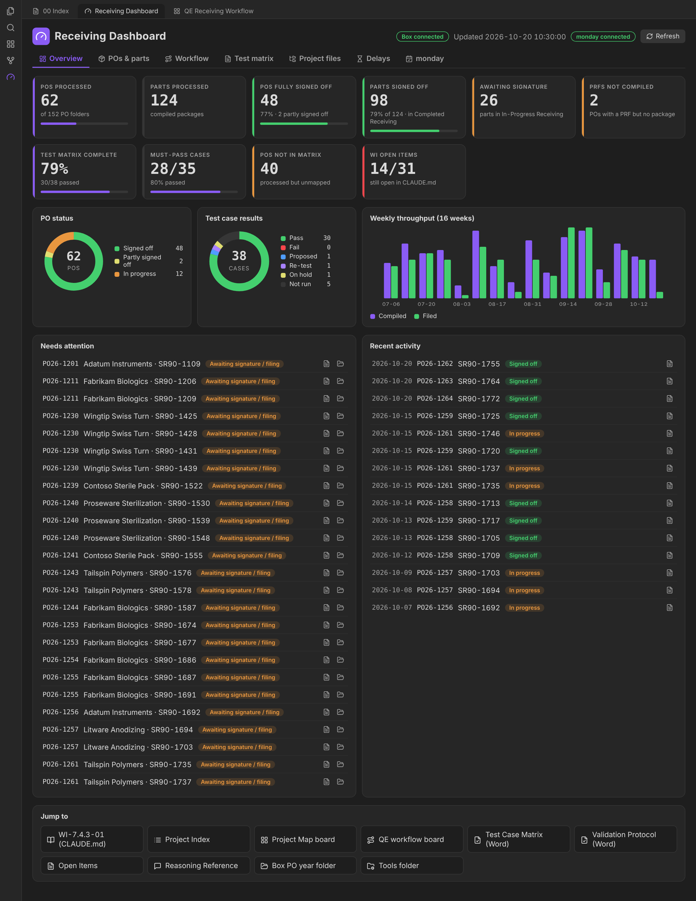
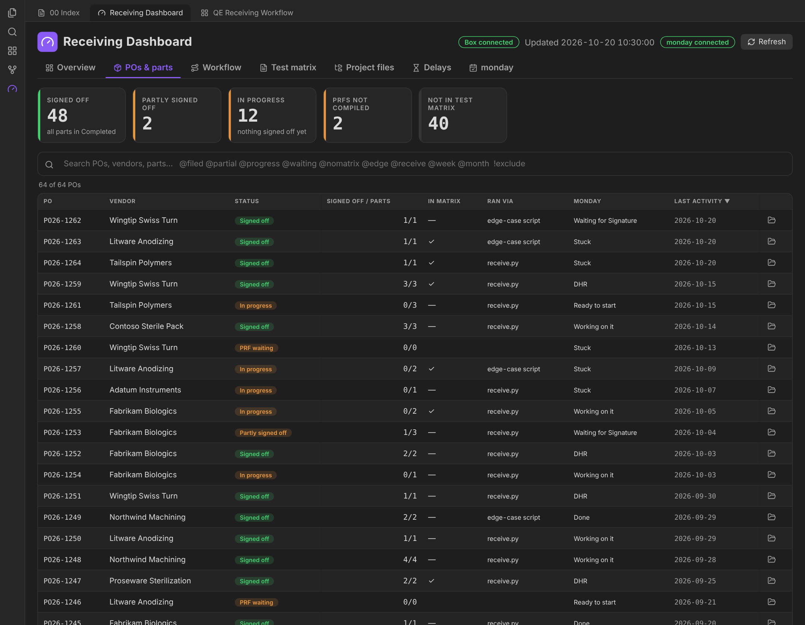
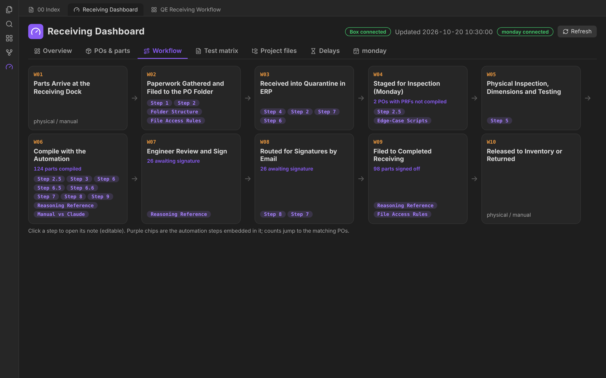
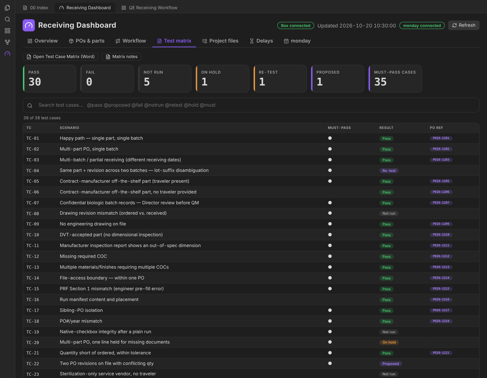
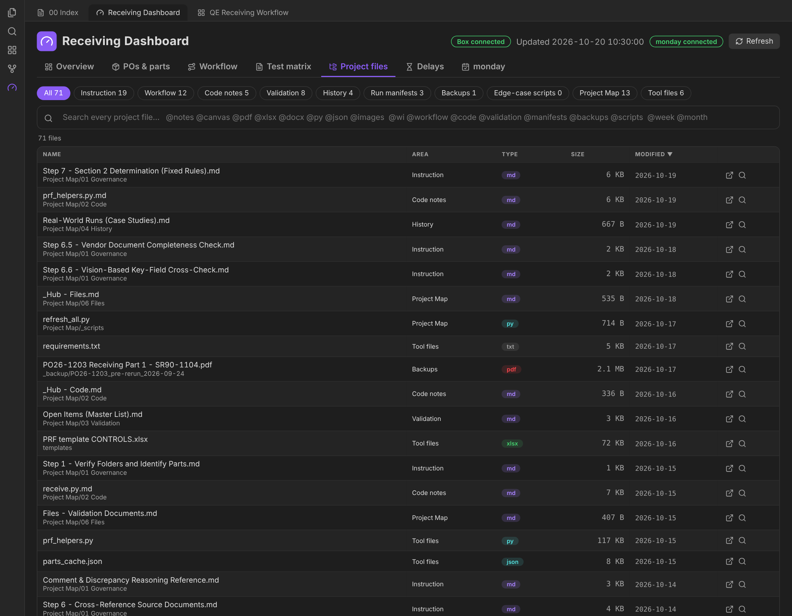
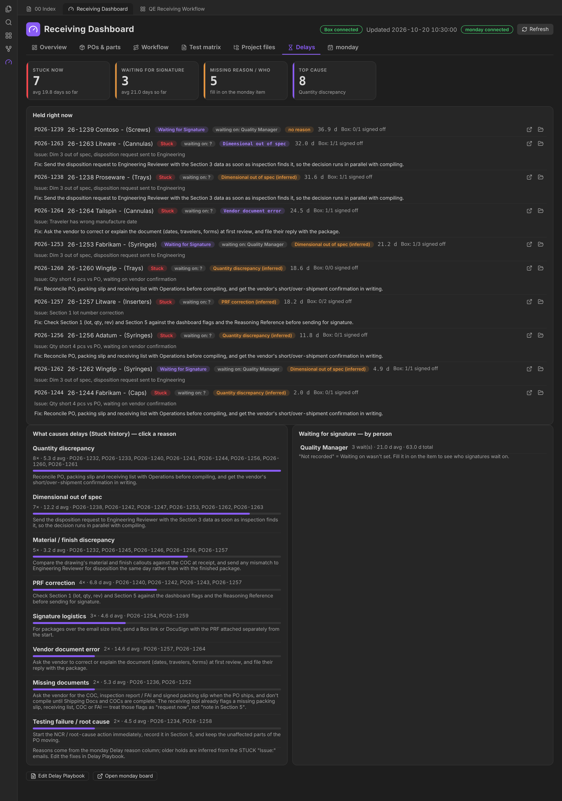
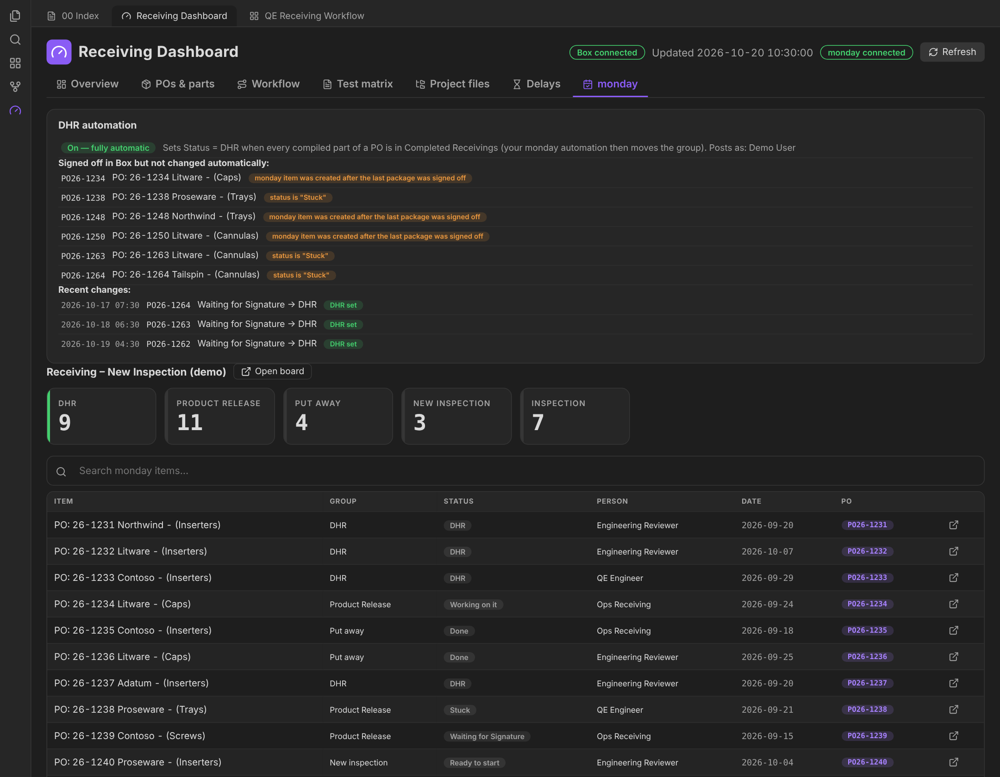

# 06 · Receiving Dashboard (Obsidian plugin)

A desktop-only Obsidian plugin in plain JavaScript (`main.js`, no build step) that turns the vault into a live operations view. It answers three questions without opening Box or monday:

- **Where is every PO and part?** Compiled, waiting for signatures, signed off.
- **How far along is validation?** Test matrix, must-pass cases, open items.
- **What's holding things up, and who are we waiting on?**

> Screenshots render the real plugin with **synthetic demo data** ([how](../tools/screenshot-harness)).

## Where the data comes from

```
Box Drive (PO year folder) ──read-only──┐
tools-folder/logs/*_manifest.json ──────┤
edge-case script names ─────────────────┤   refresh_dashboard.py  ──►  Project Map/_scripts/.dashboard_data.json
Validation/…Test_Case_Matrix.docx ──────┤   (stdlib only, cached)              │
CLAUDE.md Open Items ───────────────────┘                                      ▼
                                                                  Receiving Dashboard plugin ◄──► monday.com API
                                                                  (re-reads every 20 s, re-runs                (optional)
                                                                   collector every N minutes)
```

`refresh_dashboard.py` is **read-only everywhere outside `Project Map/`**:

- lists each `yy-nnnn - Vendor` PO folder and its `In-Progress Receiving` and `Completed Receivings` subfolders
- treats a package as **signed off** once it sits in `Completed Receiving(s)` (archived copies don't count)
- counts digital signatures in each filed PDF (`/ByteRange` occurrences), **cached by size + mtime** so Box Drive downloads each file only once
- finds PRFs in `Inspection Forms` that have no compiled package yet ("PRF ready, not compiled")
- tags each PO with how it was processed: `receive.py` (from manifests) or `edge-case script` (from `process_PO…py` names)
- parses the Test Case Matrix `.docx` (python `zipfile` + XML) and the Open Items count from `CLAUDE.md`

It runs on the plugin's timer, from the **Refresh** button, and from the optional Windows scheduled task.

---

## Overview



- **KPI tiles** (each is clickable and jumps to the filtered list): POs processed out of PO folders, parts processed, POs and parts signed off, awaiting signature, PRFs not compiled, test-matrix completion, must-pass progress, POs not yet mapped to a test case, WI open items.
- **PO status donut** and **test-case results donut**. Click a legend row to filter.
- **Weekly throughput**: packages compiled vs. filed over the last 16 weeks.
- **Needs attention**: every part awaiting signature and every PRF waiting to be compiled, with buttons to open the package or the PO folder.
- **Recent activity** and **Jump to**: the WI, Index, both canvases, the validation Word documents, Open Items, the Reasoning Reference, the Box year folder and the tools folder.

## POs & parts



One row per PO: vendor, status (*Signed off / Partly signed off / In progress / PRF waiting*), signed-off/parts, whether it is in the test matrix, how it ran, the **monday status** of the matching item, and last activity. Click a row to expand its parts, each with **Package** (open the PDF) and **Show** (reveal in Explorer).

### Search syntax (POs, matrix, files)

| Token | Meaning |
|---|---|
| `word` | must contain (all words AND-ed) |
| `!word` | must not contain |
| `@filed` `@partial` `@progress` `@waiting` | status filters |
| `@nomatrix` `@inmatrix` | test-matrix coverage |
| `@edge` `@receive` | processed by an edge-case script / by `receive.py` |
| `@today` `@week` `@month` | last activity window |

Example: `@progress @week !VendorB`

## Workflow



The ten physical steps are read **live from the `05 QE Workflow/W*.md` notes**. Each card shows:

- a live count where one applies, for example W04 *PRFs not compiled*, W06 *parts compiled*, W07/W08 *awaiting signature*, W09 *signed off*. Click it to jump to those POs.
- purple chips for the WI steps linked from that note (from Obsidian's link cache), so edit the note and the card changes
- *physical / manual* when no automation is involved

## Test matrix



The matrix is parsed from the controlled Word document (Attachment A). Tiles show Pass / Fail / Not run / On hold / Re-test / Proposed / Must-pass. PO references become chips that jump to the PO. Search with `@pass @fail @notrun @hold @retest @proposed @must`.

## Project files



A navigator for **every file in the tools folder**, grouped into areas: Instruction, Workflow, Code notes, Validation, History, Run manifests, Backups, Edge-case scripts, Project Map and Tool files. Ghostscript, `__pycache__` and dot-files are hidden. Notes and canvases open in Obsidian. Everything else opens in its default app (Word, Excel, Acrobat). Filter with `@notes @canvas @pdf @xlsx @docx @py @json @images @wi @workflow @code @validation @manifests @backups @scripts`.

<a id="delays"></a>
## Delays (monday)



This tab reads the monday board's **status history** (activity log) and **updates**, and answers:

- **Held right now.** Every item in *Stuck* or *Waiting for Signature*: how many days, **waiting on** whom, the **delay reason**, the last *Issue:* text, Box sign-off progress for that PO, and the playbook **Fix**.
- **What causes delays.** Stuck episodes grouped by reason, with count, average days and which POs. Click a reason to list every past hold.
- **Waiting for signature, by person.** Wait count, average and total days per signer.

The delay reason comes from the monday **Delay reason** column. For older holds where nobody set it, the reason is **inferred** from the `STUCK - … / Issue: …` update text with a small keyword classifier (`categorizeIssue()`), and is shown as "(inferred)".

The **Fix** text comes from `Project Map/04 History/Delay Playbook.md`. Each `## heading` must match a Delay-reason label, and the first paragraph under it is shown. Edit the note and the dashboard updates.

## monday



- **DHR automation card.** Shows whether auto-DHR is on, which account it posts as, POs that are signed off in Box but were **not** changed automatically (with the reason), and the last changes from `.monday_dhr_log.jsonl`.
- **Group tiles** and a searchable table of every item: group, status, person, date and PO chip (jumps to the POs tab).

See [integrations/monday.md](integrations/monday.md) for the board setup and the exact DHR rule.

## Settings

| Setting | Default | Notes |
|---|---|---|
| Python command | `python` | used to run the collector |
| PO year folder | *(blank = default Box path)* | read-only, never written |
| Refresh every (minutes) | 5 | rescans Box while Obsidian is open, and picks up scheduled-task refreshes |
| Show monday tab | off | adds the **Delays** and **monday** tabs |
| API token | none | stored in the vault's plugin `data.json` **on this computer only**. Never commit it (`.gitignore` covers it) |
| Board ID | none | the receiving / new-inspection board |
| Set DHR automatically | on | see the monday page |

## Commands

- **Open Receiving Dashboard** (also the gauge icon in the ribbon)
- **Refresh dashboard data now**

## Implementation notes

- No framework and no bundler: one `main.js` using Obsidian's DOM helpers (`createDiv`, `setIcon`) and inline SVG charts.
- The pure helpers (`parseQuery`, `filterPOs`, `dhrCandidates`, `delayModel`, `categorizeIssue`…) are exported on `module.exports.helpers` and unit-tested on their own.
- The only process it ever starts is the read-only collector, via `execFile`, with a 15-minute timeout and no window.
